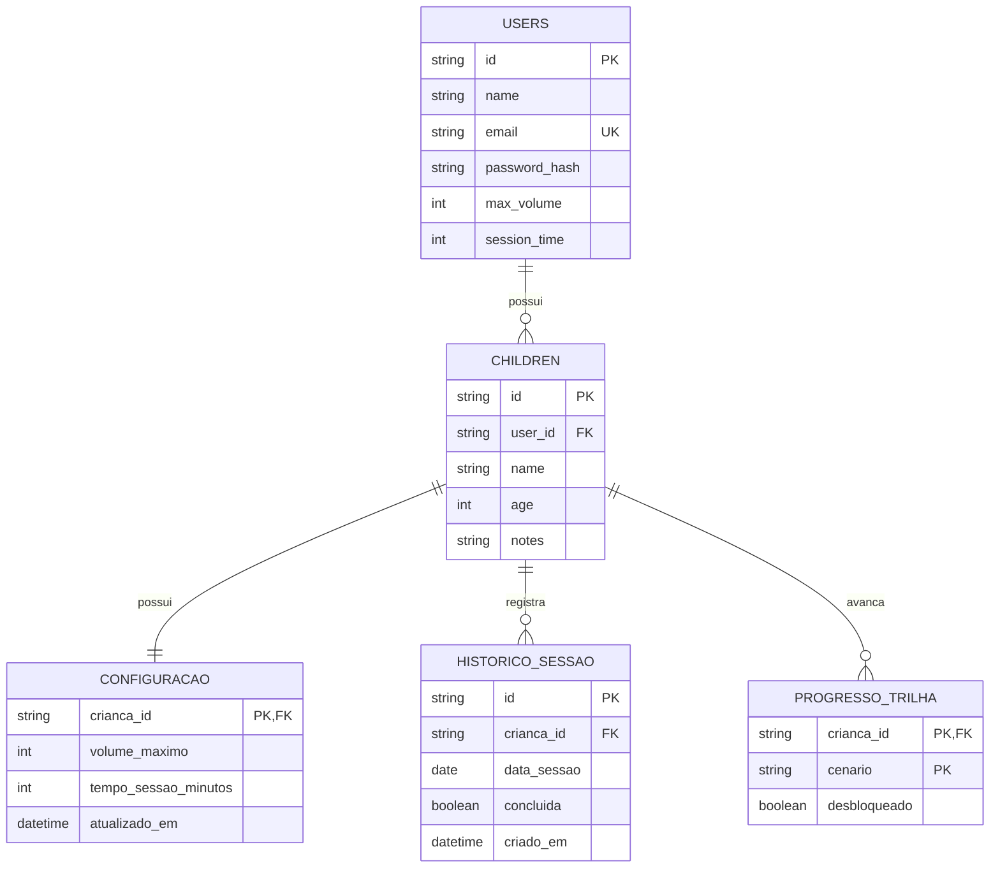

# Ludo

Aplicativo móvel de apoio à dessensibilização auditiva de crianças com Transtorno do Espectro Autista (TEA) e hipersensibilidade auditiva. O Ludo expõe a criança, de forma gradual e lúdica, a sons do cotidiano (despertador, televisão, pássaros, sinal da escola, buzina) organizados em uma trilha de cenários progressivos: quarto, sala, parque, rua e escola. A criança controla o volume dentro de um teto seguro e pode interromper a reprodução a qualquer momento, enquanto o responsável configura os limites e acompanha o progresso em uma área protegida.

Projeto individual da disciplina de Desenvolvimento de Projetos para Dispositivos Móveis (UTFPR 2026/2), integrado ao Trabalho de Conclusão de Curso da autora.

## Sobre o app

O Ludo atende dois perfis complementares:

- **Criança**: interface lúdica de carga cognitiva mínima, com trilha de cenários sonoros, player com controle deslizante de volume, botão "Pare" em destaque, modo suave (frequências reduzidas) e reforço visual por progresso.
- **Responsável (mediador)**: área restrita com autenticação, configuração do volume máximo permitido, tempo de sessão (5 ou 10 minutos) e acompanhamento da utilização semanal.

### Funcionalidades básicas (prioritárias)

- [x] Autenticação do responsável (login com e-mail e senha, sessão persistida no dispositivo)
- [x] Área do responsável com configuração de volume máximo e tempo de sessão
- [x] Trilha de cenários sonoros progressivos com bloqueio/desbloqueio por etapa
- [x] Player de áudio com controle gradual de volume limitado ao teto configurado
- [x] Botão de interrupção imediata ("Pare") e modo suave de reprodução
- [x] Visualização da utilização semanal na área do responsável
- [ ] Persistência local com SQLite (histórico de sessões, progresso da trilha e configurações offline)
- [ ] Validação de formulários com Zod (login, cadastro e configurações)
- [ ] Estilização unificada com NativeWind
- [ ] Sistema de recompensas visuais ao cumprir a meta da sessão
- [ ] Substituição dos áudios reservados por sons reais (normal + suave por cenário)
- [ ] Empacotamento e distribuição do aplicativo via EAS

### Funcionalidades adicionais (trabalhos futuros)

- [ ] Mapa de locais sensorialmente amigáveis da cidade (parques e espaços silenciosos), com marcadores por nível de ruído
- [ ] Relatório de progresso exportável para o terapeuta
- [ ] Novos cenários sonoros configuráveis pelo responsável
- [ ] Sincronização do progresso local com o backend

A checklist acima é atualizada a cada Checkpoint da disciplina.

## Protótipos de tela

Os protótipos de alta fidelidade foram desenvolvidos no Figma, com paleta de tons pastéis de azul e mascote interativo, seguindo princípios de design inclusivo e acessibilidade cognitiva:

**[Visualizar protótipos no Figma](https://www.figma.com/design/aLJO24MYCTjUxijrCnMuTS/Untitled?node-id=0-1&p=f&t=0VFaLrOjCbPMc8eg-0)**

Os fluxos prototipados cobrem: autenticação e entrada, área de gestão do mediador (PIN, volume máximo, tempo de sessão e utilização da semana) e a jornada da criança (trilha de cenários e tela de reprodução sonora).

## Modelagem do banco

A persistência do aplicativo é híbrida:

- **SQLite (local, via expo-sqlite)**: banco principal do app, armazenando o perfil da criança, as configurações de segurança, o histórico de sessões e o progresso na trilha. Garante funcionamento offline, essencial para o uso doméstico sem dependência de conexão.
- **PocketBase (remoto)**: autenticação do responsável e backup das configurações, nas coleções `users` (auth) e `children`.

As entidades `USERS` e `CHILDREN` residem no PocketBase; `CONFIGURACAO`, `HISTORICO_SESSAO` e `PROGRESSO_TRILHA` serão implementadas no SQLite local durante a Sprint 6, com regras de integridade estritas (tempo de sessão restrito a 5 ou 10 minutos e teto de volume obrigatório).

## Planejamento de sprints

Sprints semanais alinhadas ao cronograma da disciplina, até a entrega final em 29/11/2026:

| Sprint | Período | Objetivo | Estimativa |
|---|---|---|---|
| 1 | 14/09 a 20/09 | Criação do repositório público, documentação do Checkpoint 1, migração da base de código existente e definição do workflow de commits | 1 semana |
| 2 | 21/09 a 27/09 | Revisão do roteamento com Expo Router: grupos de rotas `(child)` e `(parent)`, proteção de navegação da área do responsável | 1 semana |
| 3 | 28/09 a 04/10 | Migração da estilização para NativeWind, unificando o tema (paleta pastel, tipografia) | 1 semana |
| 4 | 05/10 a 11/10 | Refinamento de componentes reutilizáveis (player, trilha, cards de configuração) e avaliação da biblioteca React Native Elements | 1 semana |
| 5 | 12/10 a 18/10 | **Checkpoint 2 (entrega parcial)**: consolidação das sprints anteriores, atualização da checklist e testes de regressão | 1 semana |
| 6 | 19/10 a 25/10 | Persistência local com SQLite: tabelas de configuração, histórico de sessões e progresso da trilha | 1 semana |
| 7 | 26/10 a 01/11 | Validação de dados com Zod nos formulários de login, cadastro e configurações do responsável | 1 semana |
| 8 | 02/11 a 08/11 | Mapa de locais sensorialmente amigáveis com marcadores (módulo de mapas do React Native) | 1 semana |
| 9 | 09/11 a 15/11 | Sistema de recompensas visuais e substituição dos áudios reservados por sons reais | 1 semana |
| 10 | 16/11 a 22/11 | Empacotamento com EAS Build e testes de distribuição interna | 1 semana |
| 11 | 23/11 a 29/11 | **Checkpoint final (entrega do aplicativo)**: correções finais, cobertura de testes e atualização completa da documentação | 1 semana |

Os riscos previstos concentram-se nas Sprints 6 e 8 (SQLite e Mapas), por envolverem módulos novos; caso necessário, a Sprint 9 atua como folga de contingência, priorizando os requisitos obrigatórios sobre os adicionais.
